# Arquitetura da Rede Cívica

## O que é a Rede Cívica

A Rede Cívica é uma infraestrutura cívica digital para registrar demandas do território, categorizá-las com parâmetros públicos e acompanhar a execução por conselheiros sorteados. O sistema transforma relatos dispersos em um ciclo rastreável, da captura à conclusão.

O projeto está em alpha fechado, com dados de teste. O modelo completo, as fases e os princípios estão no [livro Rede Cívica](https://docs.redecivica.com.br/rede-civica/). A arquitetura de software é orientada a eventos e organizada em colônias autônomas que se comunicam por um barramento comum. A IA não decide nem prioriza. Todo resultado automático é marcado, versionado e rastreável.

## Repositórios

A organização mantém seis repositórios. O [perfil da organização](https://github.com/Rede-Civica) lista os repositórios e as licenças.

| Repositório | Papel | Linguagem | Artefato | Licença |
|---|---|---|---|---|
| `.github` | Governança, conduta, suporte, políticas e automação de verificação | Markdown, YAML e JavaScript | Arquivos de saúde da organização e verificação de markdown e links | AGPL-3.0 na automação; CC BY-SA 4.0 no texto |
| `docs` | Livro, especificações de software, tutoriais, guias e referências | Markdown | Conteúdo canônico publicado pelo site de documentação | CC BY-SA 4.0 no texto; AGPL-3.0 no código de verificação |
| `mvp-api` | Back-end, barramento de eventos, colônias e projeções | TypeScript (NestJS) | API REST, barramento, banco e migrations | AGPL-3.0 |
| `mvp-web` | Aplicativo do cidadão e do conselheiro | TypeScript, React e Vite | PWA map-first com fila offline | AGPL-3.0 |
| `mvp-inferencia` | Inferência self-hosted de imagem, áudio e texto | Python (FastAPI) | Serviço HTTP `/v1`, fila e motores | AGPL-3.0 |
| `mvp-docs` | Site público de documentação | JavaScript, Astro e Starlight | Site em `docs.redecivica.com.br` | AGPL-3.0 |

O repositório `.github` é público. O `docs` e os quatro repositórios de código abrem no lançamento de fevereiro de 2027. Até lá, o livro e os SDS estão publicados em [docs.redecivica.com.br](https://docs.redecivica.com.br).

## Como o sistema se organiza

- O núcleo não processa demandas. O N-0a Event Bus garante o barramento e o histórico imutável, o N-0b Registry versiona os contratos e o N-0c Observabilidade rastreia os eventos.
- Cada colônia tem estado próprio, consome eventos, processa localmente e publica novos eventos. Nenhuma colônia importa código de outra nem escreve no banco de outra.
- A API roda como monolito modular. Cada colônia já está separada para ser extraída como serviço quando o sistema escalar.
- O serviço de inferência é externo à API e responde pelo contrato `/v1`. A API mantém os motores locais para rollback.
- A D-7 mantém as projeções de leitura. O mapa, a timeline, o ranking, os relatórios e o painel público leem dessas projeções.

## Fluxo da demanda

O caminho principal vai da captura à conclusão. A moderação, a detecção de duplicidade e a memória de caminhos rodam em paralelo ao fluxo principal.

```mermaid
flowchart LR
  C["Cidadão"] -->|"registra"| D1A["D-1a Captura"]
  D1A -->|"demanda.recebida"| D1B["D-1b Normalização"]
  D1B -->|"demanda.normalizada"| D2["D-2 Georreferenciamento"]
  D2 -->|"demanda.georreferenciada"| D3["D-3 Categorização"]
  D3 -->|"demanda.categorizada"| D4["D-4 Priorização"]
  D4 -->|"demanda.ranqueada / ranking.atualizado"| D5["D-5 Agenda"]
  D5 -->|"agenda.item_disponível"| D6A["D-6a Sorteio"]
  D6A -->|"conselheiro.sorteado"| D6B["D-6b Relatoria"]
  D6B -->|"conselheiro.demanda_iniciada / conselheiro.atualização_publicada"| D7["D-7 Transparência"]
  D6B -->|"demanda.concluída"| D7
  D1A -->|"anexo"| D1C["D-1c Anexos"]
  D1C -->|"anexo.processado"| D1D["D-1d Moderação"]
  D1D -->|"moderacao.decidida"| D7
  D3 -->|"demanda.categorizada"| D12["D-12 Duplicidade"]
  D12 -->|"duplicidade.agregada"| D4
  D12 -->|"demanda.conclusao_confirmada"| D5
  D6B -->|"conselheiro.atualização_publicada / demanda.concluída"| D24["D-24 Memória de caminhos"]
  D24 -->|"caminho.atualizado"| D7
  D7 -->|"timeline, ranking e relatórios"| C
```

O diagrama mostra os eventos principais. O contrato de cada evento está no [Apêndice B](https://docs.redecivica.com.br/sds/apendice-b-colonias/) e no SDS da colônia.

## Onde mexer

| Tela ou fluxo | Endpoint principal | Colônia | Modelo | Documento |
|---|---|---|---|---|
| Mapa e captura de demanda | `POST /api/demandas` | D-1a Captura | Florence-2, Whisper e OPUS-MT | [D-1a Captura](https://docs.redecivica.com.br/sds/d-1a-captura/), [D-1b Normalização](https://docs.redecivica.com.br/sds/d-1b-normalizacao/) |
| Acompanhamento e timeline | `GET /api/d7/timeline/:demanda_id`, `GET /api/d7/demanda/:demanda_id/resumo` | D-7 Transparência | Qwen2.5-1.5B-Instruct nos resumos assistidos | [D-7 Transparência](https://docs.redecivica.com.br/sds/d-7-transparencia/) |
| Ranking, agenda e dashboard | `GET /api/d7/ranking/:uc_id`, `GET /api/d7/dashboard/:uc_id` | D-4 Priorização, D-5 Agenda e D-7 | Nenhum | [D-4 Priorização](https://docs.redecivica.com.br/sds/d-4-priorizacao-e-ranking/), [D-5 Agenda](https://docs.redecivica.com.br/sds/d-5-agenda/) |
| Workspace do conselheiro | `GET /d6a/conselheiros/me/situacao`, `GET /d6b/conselheiros/me/acompanhamento` | D-6a Sorteio e D-6b Relatoria | Whisper e Qwen2.5-1.5B-Instruct | [D-6a Sorteio](https://docs.redecivica.com.br/sds/d-6a-sorteio-e-atribuicao/), [D-6b Relatoria](https://docs.redecivica.com.br/sds/d-6b-relatoria-e-acompanhamento/) |
| Moderação de conteúdo | `GET /admin/moderacao/fila`, `POST /admin/moderacao/fila/:item_id/decidir` | D-1d Moderação | NSFW, detecção de pessoa e Qwen2.5-1.5B-Instruct | [D-1d Moderação](https://docs.redecivica.com.br/sds/d-1d-moderacao/) |
| Lugares | `GET /api/d7/lugares`, `POST /api/lugares` | L-1, L-2 e L-3 | Nenhum | [L-1 Cadastro](https://docs.redecivica.com.br/sds/l-1-cadastro-de-lugares/), [L-2 Georreferenciamento](https://docs.redecivica.com.br/sds/l-2-georreferenciamento-e-tipificacao/), [L-3 Validação](https://docs.redecivica.com.br/sds/l-3-validacao-e-qualidade/) |
| Empresas | `GET /api/d7/empresas`, `POST /api/empresas/reivindicar` | E-1, E-2 e E-3 | Nenhum | [E-1 Cadastro](https://docs.redecivica.com.br/sds/e-1-cadastro-institucional/), [E-2 Transparência salarial](https://docs.redecivica.com.br/sds/e-2-transparencia-salarial-e-folha/), [E-3 Simulação](https://docs.redecivica.com.br/sds/e-3-simulacao-economica/) |
| Site de documentação | `docs.redecivica.com.br` | Não se aplica | Nenhum | Repositório `mvp-docs` (site) e repositório `docs` (conteúdo) |
| Serviço de inferência | `POST /v1/imagem/descrever`, `POST /v1/audio/transcrever`, `POST /v1/texto/resumir` | Serviço externo à API | Florence-2, Whisper, OPUS-MT e Qwen2.5-1.5B-Instruct | [Modelos de inferência](https://docs.redecivica.com.br/modelos-de-inferencia/) |

## Leia a seguir

- [Livro Rede Cívica](https://docs.redecivica.com.br/rede-civica/): modelo completo, princípios e fases.
- `contexto_IA.md`: resumo técnico-conceitual para agentes de IA, no repositório de documentação. O [guia para agentes](https://docs.redecivica.com.br/contribuir/agentes/) explica a leitura obrigatória e o uso do arquivo.
- [Apêndice B: Colônias](https://docs.redecivica.com.br/sds/apendice-b-colonias/): fichas de todas as colônias e mapa de dependências.
- SDS por área: [D-1a Captura](https://docs.redecivica.com.br/sds/d-1a-captura/), [D-6b Relatoria](https://docs.redecivica.com.br/sds/d-6b-relatoria-e-acompanhamento/) e [D-7 Transparência](https://docs.redecivica.com.br/sds/d-7-transparencia/).
- [Modelos de inferência](https://docs.redecivica.com.br/modelos-de-inferencia/): capacidades, runtime, limites e uso.
- [Guia de contribuição](CONTRIBUTOR_HANDBOOK.md): setup, primeiro pull request, gates e CLA.

## Governança e suporte

| Assunto | Documento |
|---|---|
| Governança | [GOVERNANCE.md](GOVERNANCE.md) |
| Mantenedores | [MAINTAINERS.md](MAINTAINERS.md) |
| Escada de contribuição | [CONTRIBUTOR_LADDER.md](CONTRIBUTOR_LADDER.md) |
| Roadmap | [ROADMAP.md](ROADMAP.md) |
| Suporte e prazos | [SUPPORT.md](SUPPORT.md) |
| Conduta | [CODE_OF_CONDUCT.md](CODE_OF_CONDUCT.md) |
| Segurança da informação | [SECURITY.md](SECURITY.md) |
| Política de IA | [AI_POLICY.md](AI_POLICY.md) |
| Discussões | [DISCUSSIONS.md](DISCUSSIONS.md) |

Este documento é uma página de orientação. O contrato técnico de cada colônia está no SDS. O livro vence em caso de divergência.
